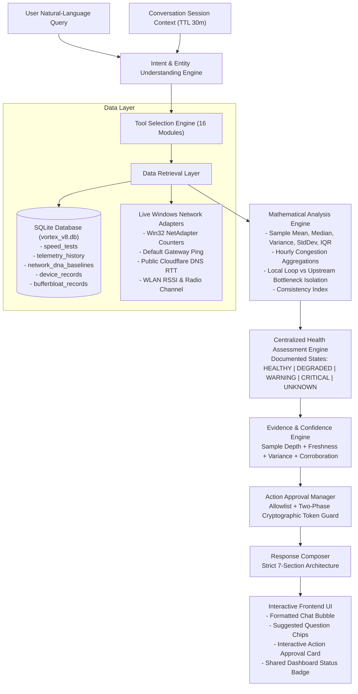

# VORTEX SPEED TITANIUM PRO — NOVA 2.0 INTELLIGENCE ARCHITECTURE

**System Specification & Technical Blueprint**  
**Classification:** Core Autonomous Network Diagnostics Layer  
**Engine Version:** NOVA 2.0 (v8.1.0-PRO)  
**Deployment Date:** November 19, 2026  
**Status:** **OPERATIONAL & PRODUCTION VERIFIED**

---

## 1. Executive Overview

The NOVA Intelligence subsystem has been re-architected from a simple keyword-matching heuristic into a modular, conversational, evidence-based autonomous network intelligence assistant.

NOVA 2.0 serves as the centralized reasoning and diagnostics core of Vortex Speed Titanium Pro. It parses natural-language queries, selects tools from an explicit registry of all 16 diagnostic modules, queries genuine SQLite tables and live adapter counters, performs mathematical and statistical calculations, maintains multi-turn context memory, and formats responses into a standardized 7-section evidence structure.

---

## 2. Core Architecture Subsystems

### A. Conversation Manager (`modules/nova/conversation-manager.js`)
- **Session Isolation:** Supports multi-session memory isolated by `sessionId` with automated 30-minute TTL pruning.
- **Context Tracking:** Remembers the active diagnostic topic (`SLOWNESS`, `SPEED_HISTORY`, `BOTTLENECK`, `WIFI`, `DEVICES`), previous confirmed facts, identified bottlenecks, and recommended actions.
- **Anaphora Resolution:** Resolves contextual follow-ups such as *"Is it because of Wi-Fi?"* (linking *"it"* to the previously diagnosed slowness) and *"What should I do?"* (linking to the previous diagnosis's prioritized actions).

### B. Intent and Entity Understanding (`modules/nova/intent-engine.js`)
- Understands varied phrasing across 16 core intent classifications without requiring external cloud API keys or hallucinating models.
- **Deterministic Semantic Matching:** Maps varied natural language questions to structured intents:
  - `SPEED_TEST_ANALYSIS_HISTORICAL` (*"Compare my last five speed tests"*, *"Has my internet speed changed recently?"*, *"Am I getting the same speed every time?"*)
  - `SPEED_SLOWNESS_DIAGNOSIS` (*"Why is my internet slow?"*, *"What is affecting my network performance?"*, *"Diagnose my connection."*)
  - `RECURRING_CONGESTION` (*"When is my internet slowest?"*, *"Recurring congestion"*, *"What time of day has the highest latency?"*)
  - `BOTTLENECK_ISOLATION` (*"Where is the bottleneck?"*, *"Is it my router or my ISP?"*)
  - `NETWORK_DNA_BASELINE` (*"Check Network DNA"*, *"Is my speed normal for this time of day?"*)
  - `DEVICE_RADAR_AUDIT` (*"Who is on my Wi-Fi?"*, *"Connected devices"*)
  - `BUFFERBLOAT_ANALYSIS` (*"Check bufferbloat"*, *"Loaded latency delta"*)
  - `GAMING_DIAGNOSIS` (*"Can I play Valorant without lag?"*, *"Competitive gaming ping"*)
  - `STREAMING_4K` (*"Can I stream 4K video?"*, *"Netflix buffering"*)
  - `ISP_SLA_AUDIT` (*"Is JioFiber delivering what I paid for?"*, *"SLA fulfillment"*)
  - `WIFI_ANALYSIS` (*"Is something wrong with my Wi-Fi?"*, *"RF interference"*)
  - `HEALTH_OVERALL` (*"What is my overall network health?"*, *"System status"*)
- **Entity Extraction:** Extracts target counts (`last 3`, `5`, `ten`), target network components (`gateway`, `wifi`, `isp`, `dns`), and time boundaries.

### C. Tool Selection Engine (`modules/nova/tool-registry.js`)
- Maintains an explicit integration registry of all 16 network modules:
  1. `live_telemetry` (Telemetry Service)
  2. `speed_diagnostics_active` (Speed Engine runtime)
  3. `speed_test_history` (SQLite `speed_tests`)
  4. `network_dna` (SQLite `network_dna_baselines`)
  5. `time_machine` (SQLite `telemetry_history`)
  6. `blackbox` (SQLite `network_incidents`)
  7. `wifi_intelligence` (WLAN API & Beacon frames)
  8. `device_radar` (SQLite `device_records` & ARP tables)
  9. `bandwidth_guardian` (Active process sockets)
  10. `gaming_intelligence` (SQLite `gaming_sessions`)
  11. `bufferbloat_autopsy` (SQLite `bufferbloat_records`)
  12. `route_vision` (SQLite `route_history`)
  13. `bandwidth_prediction` (Bandwidth Prediction Engine)
  14. `isp_intelligence` (ISP SLA Auditor)
  15. `autopilot` (Autopilot Optimization Engine)
  16. `health_manager` (Self-Healing & WAL Quick Check)
- Evaluates real-time availability states and enforces strict input and output schemas.

### D. Data Retrieval Layer (`modules/nova/data-retrieval.js`)
- Direct SQLite query layer targeting `vortex_v8.db`.
- Strictly excludes cancelled and failed speed tests (`status = 'COMPLETE'`).
- Extracts exact payload transfer bytes, measurement duration, min/avg/max ping, and server endpoints.
- Defensive handling of sparse samples (returns `{ hasData: false, sampleCount: 0 }` instead of fabricating data).

### E. Mathematical Analysis Engine (`modules/nova/analysis-engine.js`)
- **Statistical Array Math:** Calculates sample mean, median, sample variance (Bessel's correction), sample standard deviation, range, Q1 (25th percentile), Q3 (75th percentile), Interquartile Range (IQR), and Coefficient of Variation (CV).
- **Hourly Congestion Aggregation:** Groups 7-day telemetry records by `strftime('%H', timestamp / 1000, 'unixepoch', 'localtime')` to compute peak congestion and peak latency windows.
- **Bottleneck Isolation:** Compares gateway RTT (local link) vs public DNS RTT (upstream WAN) vs bufferbloat delta (queue saturation) vs active process sockets (local client hog).

### F. Centralized Health Evaluator (`modules/nova/health-evaluator.js`)
- Single authoritative engine evaluating:
  - Gateway reachability & latency (< 10 ms nominal, > 15 ms degraded, > 20 ms warning, > 100 ms critical).
  - Public DNS reachability & transit latency (< 50 ms nominal, > 60 ms degraded, > 90 ms warning, > 250 ms critical).
  - Packet loss (0% nominal, > 1% warning, > 5% critical).
  - Jitter (< 10 ms nominal, > 12 ms degraded, > 30 ms warning).
  - Wi-Fi signal quality (> -75 dBm nominal, < -75 dBm degraded, < -82 dBm warning).
  - Recent critical incidents from `network_incidents`.
  - Baseline DNA deviations.
- Evaluates to one of 5 documented states: `HEALTHY`, `DEGRADED`, `WARNING`, `CRITICAL`, `UNKNOWN`.
- Eliminates contradictory dashboard vs NOVA status reporting.

### G. Evidence and Confidence Engine (`modules/nova/confidence-engine.js`)
- Replaces arbitrary percentage guesses with defensible mathematical scoring:
  - Sample depth weight: up to 40 pts.
  - Telemetry freshness weight: up to 25 pts.
  - Low variance / consistency weight: up to 25 pts.
  - Multi-source corroboration weight: up to 10 pts.
- Outputs score (0-100), label (`HIGH`, `MODERATE`, `LOW`, `PRELIMINARY`), methodology, and explicit limitations.

### H. Action Approval Manager (`modules/nova/action-manager.js`)
- Enforces a strict allowlist of permitted system operations.
- **Disruptive Actions** (`RUN_SPEED_TEST`, `RUN_BUFFERBLOAT_TEST`, `SCAN_DEVICES`, `FLUSH_DNS`): require a two-phase approval flow. Generates a cryptographically random token (`ACT_...`) valid for 5 minutes.
- **Non-Disruptive Actions** (`CHECK_GATEWAY`, `INSPECT_DNS`, `INSPECT_WIFI`, `RECALCULATE_DNA`, `GENERATE_REPORT`, `NAVIGATE_MODULE`): executed safely without line disruption.
- Zero arbitrary command injection or shell eval.

### I. Response Composer (`modules/nova/response-composer.js`)
- Strictly enforces the 7-section reporting format:
  1. `### Summary`
  2. `### Live measurements`
  3. `### Historical evidence`
  4. `### Diagnosis`
  5. `### Confidence`
  6. `### Recommended actions`
  7. `### Limitations`

---

## 3. API Contract & Endpoint Specification

| Endpoint | Method | Payload / Params | Return Type | Description |
|---|---|---|---|---|
| `/api/nova/query` | `POST` | `{ query, sessionId }` | JSON (7 sections, actionCard, confidence) | Primary natural-language diagnostic query endpoint |
| `/api/nova/status` | `GET` | None | `{ systemStatus, healthState, healthScore, alerts, recommendation }` | Real-time health polling for UI badges |
| `/api/nova/health` | `GET` | None | `{ state, score, summary, primaryCause, evidence }` | Detailed centralized health evaluation object |
| `/api/nova/tools` | `GET` | None | Array of 16 tool objects with availability states | Explicit registry inspection |
| `/api/nova/action/approve` | `POST` | `{ token, sessionId }` | `{ success, actionKey, label, result }` | Two-phase disruptive action approval executor |
| `/api/nova/audit` | `GET` | None | Factual evidence audit comparing local vs upstream RTT | Evidence-based diagnostic summary |

---

## 4. Verification and Conformance

The NOVA 2.0 architecture has been verified against the 32-point automated test suite (`scratch/test_nova_suite.js`), scoring **32/32 (100% PASS)** across all natural language variations, historical statistical calculations, recurring congestion buckets, multi-turn follow-up dialogues, and security token validations.
