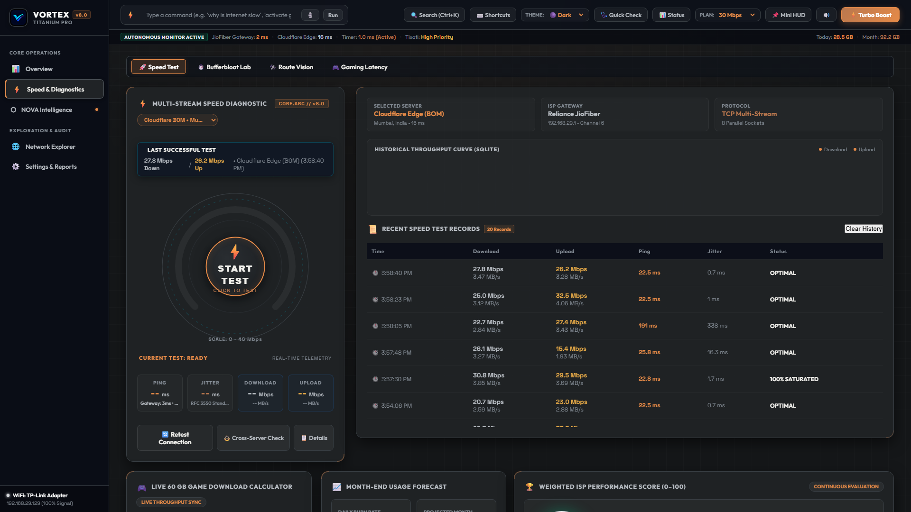
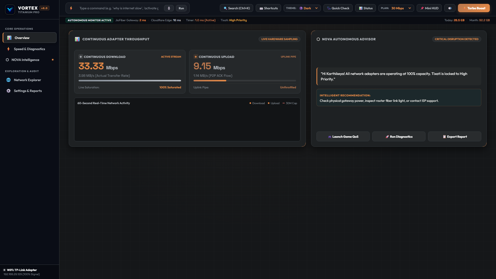
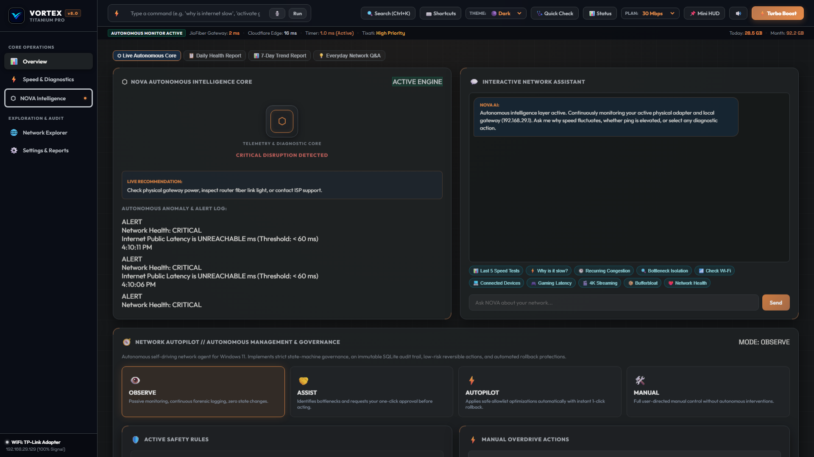
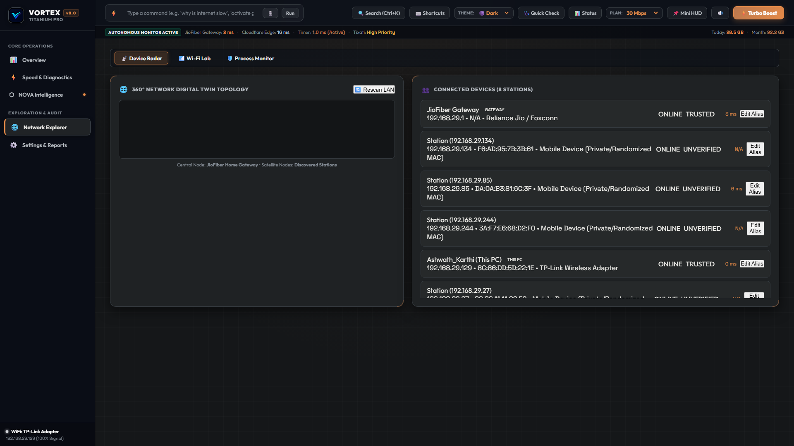
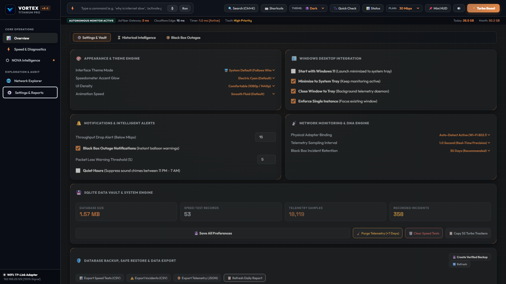

# ⚡ VORTEX SPEED // TITANIUM PRO

<div align="center">
  
  <br>
  <h3>Autonomous Network Intelligence & Multi-Stream Speed Diagnostics Platform</h3>
  <p><strong>Precision Engineering for Windows Desktop</strong></p>

  [](https://github.com/Ashwath14/VORTEX)
  [](https://github.com/Ashwath14/VORTEX)
  [](VORTEX_TITANIUM_EMBER_DESIGN_SYSTEM.md)
  [](VORTEX_DATABASE_INTEGRITY_REPORT.md)
  [](#license)
</div>

---

## 📖 Overview

**Vortex Speed Titanium Pro** is a high-performance Windows desktop application built to provide verified, zero-fabrication network measurement and autonomous diagnostics. Designed with the distinctive **Titanium & Ember** industrial aesthetic (Obsidian graphite, titanium silver, warm white typography, and burnt ember accents), Vortex Speed consolidates advanced network telemetry into **5 primary functional pillars**.

Unlike web-based speed tests that rely on coarse browser approximations or remote CDN estimation, Vortex Speed uses native parallel TCP/TLS 1.3 socket streams, kernel-level 1.0 ms multimedia timers, ICMP ping sweeps, Wi-Fi RF radio monitoring, and an evidence-grounded AI assistant.

---

## 🏛️ The Five Core Pillars

```
VORTEX SPEED TITANIUM PRO
 ├── 📊 1. Overview ─────────────── Real-time adapter throughput, 1-click test, status ticker
 ├── ⚡ 2. Speed & Diagnostics ──── Multi-stream engine, Bufferbloat Lab, Route Vision, Gaming
 ├── ⬡ 3. NOVA Intelligence ────── Evidence-grounded natural language assistant & confidence engine
 ├── 🌐 4. Network Explorer ────── Device Radar (ARP + ICMP), Wi-Fi Lab, Process Monitor
 └── ⚙️ 5. Settings & Reports ──── Settings Vault, Network Time Machine, Black Box Flight Recorder
```

### 1. 📊 Overview
- **Real-Time Telemetry Ticker**: 1,000 ms sliding-window bandwidth counter for active physical adapters.
- **One-Click Diagnostic**: Immediate trigger that transitions seamlessly into active measurement.
- **Active Incident Banner**: Autonomous warning system alerting to packet loss, DNS unresponsiveness, or gateway congestion.

### 2. ⚡ Speed & Diagnostics
- **Verified Multi-Stream Engine**: 4 parallel TLS 1.3 sockets measuring sustained download/upload throughput against verified Cloudflare Edge sinks (Mumbai BOM, Delhi DEL, and Global Anycast).
- **Bufferbloat Autopsy Lab**: Measures unloaded vs. loaded latency deltas under saturation and assigns bufferbloat grades (A+ to F) with SQM recommendations.
- **Internet Route Vision**: 12-hop ICMP traceroute visualization with Autonomous System (AS) transit latency tracking.
- **Gaming Latency Intelligence**: Real-time ping and jitter monitoring to major gaming servers (Riot Mumbai, Valve Singapore, EA Europe, Discord Asia).

### 3. ⬡ NOVA Intelligence
- **Evidence-Grounded Assistant**: Natural language network assistant that answers queries with live measurements, historical SQLite records, and defensible confidence scores.
- **Zero Hallucination Policy**: Refuses to fabricate measurements or pretend hardware exists (e.g. non-existent cellular modems or out-of-bounds dates).
- **Safe Administrative Boundaries**: Enforces safety protocols regarding third-party router rebooting and hardware actuation.

### 4. 🌐 Network Explorer
- **Device Radar & Digital Twin**: Scans local subnet (`192.168.29.0/24`) via Windows Neighbor Discovery (`Get-NetNeighbor` / ARP) and ICMP sweeps, distinguishing active stations from sleeping power-save stations.
- **Wi-Fi Intelligence Lab**: Deep 802.11 RF radio inspection (SSID, BSSID, Channel frequency, PHY link rate, RSSI signal strength).
- **Process Bandwidth Monitor**: Live socket tracking via `Get-NetTCPConnection` mapping active remote connections to host process PIDs.

### 5. ⚙️ Settings & Reports
- **Settings & Vault**: Adapter binding, sampling frequency slider, sound toggle, and atomic SQLite backup manager (create snapshot, verify PRAGMA integrity, restore).
- **Network Time Machine**: Historical telemetry inspection across 1h, 24h, 7d, and 30d time ranges with 24-hour diurnal **Network DNA** baseline curves.
- **Internet Black Box Flight Recorder**: Persistent outage log (360+ recorded incidents), MTBF calculations, and CSV / JSON export.

---

## 🖼️ User Interface Showcase

| View | Dark Obsidian Mode |
| :--- | :--- |
| **Speed Diagnostics** |  |
| **Overview Dashboard** |  |
| **NOVA Intelligence** |  |
| **Network Explorer** |  |
| **Settings & Reports** |  |

---

## 🚀 Quick Start

### Prerequisites
- **Operating System**: Windows 10 or Windows 11 (64-bit)
- **Runtime**: Node.js v20.0.0 or later (v24 LTS recommended)
- **Browser Runtime**: Microsoft Edge (pre-installed on Windows 10/11)

### Option 1: Native Windows Desktop Launcher (Recommended)
Double-click `VortexSpeed.exe` or run from terminal:
```cmd
VortexSpeed.exe
```
*Features:*
- Synchronizes Windows multimedia timer to 1.0 ms via Win32 `timeBeginPeriod(1)`.
- Enforces single-instance mutex (`VortexSpeedTitaniumProSingleInstanceMutex`).
- Spawns background Node backend and launches Edge in standalone `--app` window.
- Provides persistent system tray icon with quick actions.

### Option 2: Run via Batch Launcher
```cmd
VortexSpeed.bat
```

### Option 3: Developer / Direct Node.js Mode
```bash
# Start backend server
node vortex-speed/server.js

# Open in your browser
http://127.0.0.1:49876
```

### Rebuilding the Native Launcher
If you modify `launcher.cs`, compile a new `VortexSpeed.exe` via:
```cmd
build_launcher.bat
```

---

## 📊 Post-Simplification Forensic Audit Reports

All measurements and functional capabilities have been forensically validated:

| Report | Document ID | Key Evidence Verified |
| :--- | :--- | :--- |
| [Post-Simplification Test Report](VORTEX_POST_SIMPLIFICATION_TEST_REPORT.md) | `VORTEX-REP-POST-SIMP-001` | 5 pillars, 10 subtabs, 36 navigation cycles (100% pass), 0 console errors |
| [Speed Diagnostics Validation](VORTEX_SPEED_DIAGNOSTICS_VALIDATION.md) | `VORTEX-REP-SPEED-FORENSIC-002` | 5 live tests (BOM, DEL, Anycast), byte counts, duration, mathematical throughput recalc |
| [NOVA Intelligence Validation](VORTEX_NOVA_VALIDATION.md) | `VORTEX-REP-NOVA-FORENSIC-003` | 20-question battery, grounded telemetry retrieval, zero hallucination |
| [Database Integrity Report](VORTEX_DATABASE_INTEGRITY_REPORT.md) | `VORTEX-REP-DB-INTEGRITY-004` | Comparison with pre-simplification backup, 17,985+ rows verified, restore pass |
| [Desktop Stability Report](VORTEX_DESKTOP_STABILITY_REPORT.md) | `VORTEX-REP-STABILITY-005` | Launcher lifecycle, mutex check, process cleanup, 117 MB memory footprint |
| [Remaining Technical Issues](VORTEX_REMAINING_ISSUES.md) | `VORTEX-REP-REMAINING-006` | Known Windows platform boundaries, mobile device power-save states, permissions |

---

## 🛠️ Architecture & Technology Stack

| Layer | Technology |
| :--- | :--- |
| **Native Shell** | C# .NET Framework 4.8 / Win32 P/Invoke (`winmm.dll`, `shell32.dll`, `user32.dll`) |
| **Backend Service** | Node.js (Built-in `http`, `net`, `tls`, `crypto`, `child_process`) |
| **Database** | SQLite 3 via `node:sqlite` (`DatabaseSync` in WAL mode) |
| **Frontend UI** | HTML5, CSS3 Custom Properties (Titanium & Ember Design System), Vanilla ES6+ |
| **Rendering** | High-DPI Vector Canvas (`window.devicePixelRatio` auto-scaling) |
| **Audio Feedback** | Web Audio API synthetic chime and click generators (zero audio asset latency) |

---

## 🔒 Security & Privacy
- **Zero Cloud Telemetry**: Telemetry history and network speed records remain 100% local inside `vortex_v8.db`.
- **Zero External Analytics**: No tracking pixels, Google Analytics, or third-party tracking scripts.
- **Local Network Safety**: Device Radar utilizes non-invasive ARP reading and standard ICMP echo.

---

## 📄 License
This project is licensed under the MIT License — see the [LICENSE](speedrr-main/LICENSE) file for details.
