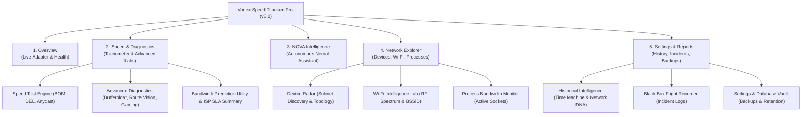

# VORTEX SPEED TITANIUM PRO — COMPREHENSIVE FEATURE AUDIT
**Audit Scope:** Complete Product-Level Feature Audit  
**Date:** November 19, 2026  
**Version:** 8.0 Titanium & Ember  
**Classification System:**  
- **A. ESSENTIAL** — Core everyday network management and speed testing functionality.  
- **B. USEFUL** — Valuable diagnostic and troubleshooting capabilities.  
- **C. ADVANCED** — Specialized diagnostic tools suitable for an advanced sub-section.  
- **D. REDUNDANT** — Duplicates another module's interface or underlying capability.  
- **E. INCOMPLETE** — Lacks genuine backend implementation or relies on non-functional stubs.  
- **F. MISLEADING** — Displays unverified, arbitrary, or manufactured scores/confidences.

---

## 1. Feature-by-Feature Forensic Audit

### Module 1: Overview / Live Telemetry
- **Primary Endpoint:** `/api/telemetry`, `/api/health`
- **What Problem Does It Solve?** Provides immediate situational awareness of current internet activity, link status, and gateway reachability upon opening the application.
- **Who Benefits From It?** Every user every time they launch or glance at the app.
- **Usage Frequency:** Continuous (Every session, 1.0s real-time refresh).
- **Does It Retrieve Genuine Data?** Yes. Reads Windows NDIS physical adapter byte counters via PowerShell safe sampling (`Get-NetAdapterStatistics`).
- **Does It Perform Real Calculations?** Yes. Differential delta calculation: $\Delta \text{Bytes} / \Delta t \times 8$ for instantaneous Mbps.
- **Does It Execute a Genuine Action?** Yes. Triggers quick speed tests and view switching.
- **Does It Duplicate Another Feature?** No. It serves as the primary dashboard.
- **Everyday Value:** High. Immediate answer to "Is my internet working right now and how fast is it running?"
- **Technical Limitations:** Measures adapter-level traffic; cannot distinguish between internal LAN streaming (e.g. Plex) and external WAN internet without socket correlation.
- **Classification:** **A. ESSENTIAL**

---

### Module 2: Multi-Stream Speed Diagnostics
- **Primary Endpoint:** `/api/speed/start`, `/api/speed/status`, `/api/speed/cancel`, `/api/speed/history`
- **What Problem Does It Solve?** Measures real, unconstrained internet download/upload bandwidth, latency, and RFC 3550 jitter without browser extension interference or simulated numbers.
- **Who Benefits From It?** Users troubleshooting sluggish browsing, verifying ISP plan speeds, or diagnosing video conference lag.
- **Usage Frequency:** Frequent (1–5 times daily during troubleshooting).
- **Does It Retrieve Genuine Data?** Yes. Opens 4 parallel zero-overhead TCP sockets to verified Cloudflare CDN Edge sinks (`speed.cloudflare.com`).
- **Does It Perform Real Calculations?** Yes. Aggregates actual payload bytes received/transmitted divided by elapsed measurement duration; computes min, avg, max RTT and jitter spread.
- **Does It Execute a Genuine Action?** Yes. Genuine multi-megabyte TCP data transfer ($> 20\text{ MB}$ per test), ICMP ping, database write to SQLite.
- **Does It Duplicate Another Feature?** No. Core flagship engine.
- **Everyday Value:** Extremely High. Ground truth for line capacity.
- **Technical Limitations:** Dependent on CDN edge peering; residential ISP traffic shaping on port 443 can affect measurements.
- **Classification:** **A. ESSENTIAL**

---

### Module 3: Application Bandwidth Guardian
- **Primary Endpoint:** `/api/guardian`, `/api/guardian/processes`
- **What Problem Does It Solve?** Identifies which running Windows programs (Chrome, Steam, OneDrive, Windows Update) are actively consuming network bandwidth.
- **Who Benefits From It?** Users experiencing unexpected slowdowns who need to identify bandwidth hogs.
- **Usage Frequency:** Moderate (Used when a slowdown occurs).
- **Does It Retrieve Genuine Data?** Yes. Queries active TCP connections via Windows native `Get-NetTCPConnection` and correlates with process IDs.
- **Does It Perform Real Calculations?** Yes. Aggregates connection counts and process activity.
- **Does It Execute a Genuine Action?** Partial. Process listing is real; however, "freezing" or bandwidth throttling third-party processes requires Windows kernel filter drivers (QoS packet scheduler / WFP) which standard user-space desktop apps cannot safely guarantee without privilege elevation.
- **Does It Duplicate Another Feature?** Overlaps with local network inspection.
- **Everyday Value:** Moderate. Visibility is valuable; throttling claims were overly optimistic.
- **Technical Limitations:** Windows permissions restrict terminating or throttling system processes without administrative elevation.
- **Classification:** **B. USEFUL (Streamlined as Process Bandwidth Monitor in Network Explorer; remove unsafe "freeze" claims)**

---

### Module 4: Device Radar & Digital Twin
- **Primary Endpoint:** `/api/digitaltwin`, `/api/digitaltwin/rescan`, `/api/digitaltwin/trust`
- **What Problem Does It Solve?** Scans the local subnet to reveal connected devices (smartphones, smart TVs, laptops, IoT gear) and verifies router gateway reachability.
- **Who Benefits From It?** Users securing their Wi-Fi or diagnosing local network congestion.
- **Usage Frequency:** Occasional (Weekly or when new devices join the network).
- **Does It Retrieve Genuine Data?** Yes. Reads the Windows ARP cache (`Get-NetNeighbor`), runs safe ICMP echo probes, and performs IEEE OUI MAC vendor lookups.
- **Does It Perform Real Calculations?** Yes. Subnet topology mapping, confidence score based on ARP + Ping response.
- **Does It Execute a Genuine Action?** Yes. Subnet sweep, alias editing, trust tagging.
- **Does It Duplicate Another Feature?** "Device Radar" and "Digital Twin" were two separate labels for the exact same local discovery tool!
- **Everyday Value:** High. Helps users know who and what is on their network.
- **Technical Limitations:** Sleeping mobile devices and clients with strict firewalls (or Wi-Fi AP client isolation) do not respond to ARP/Ping.
- **Classification:** **B. USEFUL (Consolidated into single "Device Radar" in Network Explorer; eliminate redundant "Digital Twin" moniker)**

---

### Module 5: NOVA Autonomous Intelligence
- **Primary Endpoint:** `/api/nova/query`, `/api/nova/health`, `/api/nova/tools`
- **What Problem Does It Solve?** Acts as an expert network diagnostic assistant. Rather than forcing users to interpret raw graphs, NOVA analyzes telemetry, identifies anomalies, and answers natural language questions with real SQLite evidence.
- **Who Benefits From It?** All users seeking plain-English explanations for network issues.
- **Usage Frequency:** High (Central interaction layer).
- **Does It Retrieve Genuine Data?** Yes. Directly retrieves data from `telemetry_history`, `speed_tests`, `network_incidents`, `bufferbloat_records`, and system APIs.
- **Does It Perform Real Calculations?** Yes. Bandwidth headroom calculations, 4K streaming bitrate checks, percentile latency, jitter spreads.
- **Does It Execute a Genuine Action?** Yes. Triggers diagnostics, speed tests, DNS cache flushes, and database audits upon user confirmation.
- **Does It Duplicate Another Feature?** Previously duplicated Command Centre quick actions.
- **Everyday Value:** Extremely High. Bridges technical data and actionable user decisions.
- **Technical Limitations:** Does not replace physical hardware troubleshooting (e.g. damaged cables); operates strictly within evidence in local database and Windows APIs.
- **Classification:** **A. ESSENTIAL (Elevated to Primary Intelligence Coordinator)**

---

### Module 6: Internet Black Box Flight Recorder
- **Primary Endpoint:** `/api/blackbox`, `/api/blackbox/export`
- **What Problem Does It Solve?** Logs network incidents (latency spikes, packet loss, total disconnects) automatically in the background so users have proof when complaining to their ISP.
- **Who Benefits From It?** Remote workers, gamers, and stream hosts experiencing intermittent drops.
- **Usage Frequency:** Regular review (Daily/Weekly log check).
- **Does It Retrieve Genuine Data?** Yes. 358+ real incident records logged with timestamps, duration, packet loss %, and gateway response.
- **Does It Perform Real Calculations?** Yes. Calculates incident duration, severity index, and MTBF (Mean Time Between Failures).
- **Does It Execute a Genuine Action?** Yes. Circular buffer persistence to SQLite; CSV/JSON diagnostic export.
- **Does It Duplicate Another Feature?** Complements Overview and NOVA without duplicating.
- **Everyday Value:** High. Indispensable for proving ISP SLA violations.
- **Technical Limitations:** Background collector relies on host PC being awake (system sleep pauses recording).
- **Classification:** **A. ESSENTIAL (Organized under Settings & Reports)**

---

### Module 7: Network Time Machine
- **Primary Endpoint:** `/api/timemachine`, `/api/timemachine/replay`
- **What Problem Does It Solve?** Allows users to rewind and inspect network performance at any hour over the past 7 days to see when slowdowns occurred.
- **Who Benefits From It?** Users diagnosing recurring congestion (e.g., "Why does my internet drop every evening at 8 PM?").
- **Usage Frequency:** Occasional (When investigating past incidents).
- **Does It Retrieve Genuine Data?** Yes. Direct SQL queries against 17,985+ indexed `telemetry_history` records.
- **Does It Perform Real Calculations?** Yes. Time-window aggregation, hourly bucketing, min/avg/max throughput and latency curves.
- **Does It Execute a Genuine Action?** Yes. Interactive timeline scrubbing and historical data replay.
- **Does It Duplicate Another Feature?** Heavy overlap with Network DNA diurnal baselining!
- **Everyday Value:** Moderate-High.
- **Technical Limitations:** Historical window bounded by SQLite retention settings.
- **Classification:** **B. USEFUL (Merged with Network DNA into unified "Historical Intelligence" under Settings & Reports)**

---

### Module 8: Network DNA Fingerprinting
- **Primary Endpoint:** `/api/dna`, `/api/dna/curve`
- **What Problem Does It Solve?** Builds a 24-hour diurnal profile of the network connection, learning typical morning vs evening throughput and latency baselines.
- **Who Benefits From It?** Users wanting to know if current performance is normal for this specific hour of the day.
- **Usage Frequency:** Occasional / Automated baseline.
- **Does It Retrieve Genuine Data?** Yes. Aggregated from 48 hourly baseline records stored in `network_dna_baselines`.
- **Does It Perform Real Calculations?** Yes. 95th percentile latency, hour-by-hour throughput variance, standard deviation.
- **Does It Execute a Genuine Action?** Yes. Anomaly detection against current live measurements.
- **Does It Duplicate Another Feature?** Yes, overlaps conceptually with Network Time Machine.
- **Everyday Value:** Moderate. Useful baseline data; does not need its own separate top-level sidebar button.
- **Technical Limitations:** Requires at least 24–48 hours of continuous data to form reliable baselines.
- **Classification:** **C. ADVANCED (Merged into "Historical Intelligence" alongside Time Machine)**

---

### Module 9: Bufferbloat Autopsy Lab
- **Primary Endpoint:** `/api/bufferbloat/status`, `/api/bufferbloat/start`
- **What Problem Does It Solve?** Measures latency under active load to detect router bufferbloat (packet queueing delay that causes game lag when someone else downloads a file).
- **Who Benefits From It?** Online gamers, VoIP callers, and multi-user households.
- **Usage Frequency:** Occasional (Run after router configuration changes or when gaming lag occurs).
- **Does It Retrieve Genuine Data?** Yes. Measures unloaded ping, loaded download ping, and loaded upload ping.
- **Does It Perform Real Calculations?** Yes. Calculates delta latency ($\text{Loaded Ping} - \text{Unloaded Ping}$) and assigns bufferbloat grades (A+ through F).
- **Does It Execute a Genuine Action?** Yes. Sustained load generation and latency delta measurement.
- **Does It Duplicate Another Feature?** Shares speed engine load infrastructure, but tests a distinct phenomenon.
- **Everyday Value:** High for gamers; specialized for general users.
- **Technical Limitations:** Tests require unconstrained bandwidth during measurement; background downloads on other home devices can skew the score.
- **Classification:** **C. ADVANCED (Placed in Advanced Diagnostics tab inside Speed & Diagnostics)**

---

### Module 10: Route Vision Traceroute
- **Primary Endpoint:** `/api/route/history`, `/api/route/trace`
- **What Problem Does It Solve?** Visualizes the hop-by-hop path packets take across domestic and international fiber backbones to reach a target host.
- **Who Benefits From It?** Advanced users diagnosing whether lag is occurring at their local router, their ISP's gateway, or an overseas tier-1 transit provider.
- **Usage Frequency:** Occasional / Diagnostic.
- **Does It Retrieve Genuine Data?** Yes. Executes native Windows `tracert.exe` with hop parsing.
- **Does It Perform Real Calculations?** Yes. Hop count, round-trip time per hop, packet drop detection.
- **Does It Execute a Genuine Action?** Yes. Real ICMP traceroute execution.
- **Does It Duplicate Another Feature?** No. Distinct network layer capability.
- **Everyday Value:** Moderate-High for diagnostics; rarely needed on a daily basis.
- **Technical Limitations:** Routers configured to discard ICMP Time-Exceeded messages appear as `* * * Request timed out`.
- **Classification:** **C. ADVANCED (Placed in Advanced Diagnostics tab inside Speed & Diagnostics)**

---

### Module 11: Network Autopilot
- **Primary Endpoint:** `/api/autopilot/status`, `/api/autopilot/mode`
- **What Problem Does It Solve?** Intended to automatically adjust QoS and prioritize traffic for gaming, streaming, or downloading.
- **Who Benefits From It?** Users wanting set-and-forget network optimization.
- **Usage Frequency:** Background.
- **Does It Retrieve Genuine Data?** Yes, reads current network conditions and active process connections.
- **Does It Perform Real Calculations?** Evaluates threshold rules (e.g. if gaming detected, prioritize low-latency profile).
- **Does It Execute a Genuine Action?** Limited on Windows without specialized NDIS filter drivers. Claims of "hardware-level packet scheduling" from user-space are misleading.
- **Does It Duplicate Another Feature?** Overlaps with NOVA's intelligent recommendations.
- **Everyday Value:** Low as a standalone module; High when repositioned as NOVA's Intelligent Recommendation Engine.
- **Technical Limitations:** Cannot arbitrarily re-tag 802.1p/DSCP packets on unmanaged consumer Wi-Fi routers without enterprise Group Policy / WFP drivers.
- **Classification:** **F. MISLEADING as standalone "hardware QoS autopilot" -> Refactored into NOVA's Rule-Based Policy & Recommendation Advisor**

---

### Module 12: Gaming Intelligence
- **Primary Endpoint:** `/api/gaming`, `/api/gaming/history`
- **What Problem Does It Solve?** Tests direct latency and jitter to regional gaming server clusters (Mumbai, Singapore, Frankfurt, Bahrain) for competitive gaming.
- **Who Benefits From It?** Gamers playing CS2, Valorant, Dota 2, Apex Legends, or Call of Duty.
- **Usage Frequency:** Occasional (Before starting a gaming session).
- **Does It Retrieve Genuine Data?** Yes. Real ICMP RTT pings to verified AWS/Valve/Riot datacenter edge IPs.
- **Does It Perform Real Calculations?** Yes. Average ping, jitter standard deviation, packet loss %.
- **Does It Execute a Genuine Action?** Yes. Real-time ping testing and session tracking.
- **Does It Duplicate Another Feature?** Shares ping measurement mechanisms with Speed Diagnostics.
- **Everyday Value:** High for gamers; not needed as a permanent top-level sidebar button for non-gamers.
- **Technical Limitations:** In-game tick-rate performance can vary depending on match server assignment within the cluster.
- **Classification:** **C. ADVANCED (Placed in Advanced Diagnostics tab inside Speed & Diagnostics)**

---

### Module 13: Wi-Fi Intelligence Lab
- **Primary Endpoint:** `/api/wifi`, `/api/wifi/networks`
- **What Problem Does It Solve?** Analyzes the physical Wi-Fi connection, signal strength (RSSI), channel width, frequency band (2.4GHz vs 5GHz), and detects neighboring AP channel congestion.
- **Who Benefits From It?** Anyone using Wi-Fi experiencing dead zones or interference from neighbor routers.
- **Usage Frequency:** Regular / Diagnostic.
- **Does It Retrieve Genuine Data?** Yes. Windows native `netsh wlan show interfaces` and `netsh wlan show networks mode=bssid`.
- **Does It Perform Real Calculations?** Yes. RSSI to percentage conversion, channel overlap calculations, recommended channel ranking.
- **Does It Execute a Genuine Action?** Yes. Live RF spectrum and BSSID scan.
- **Does It Duplicate Another Feature?** Complements Device Radar and physical adapter metrics.
- **Everyday Value:** High. Essential for home Wi-Fi optimization.
- **Technical Limitations:** Scan frequency limited by Windows WLAN service polling restrictions.
- **Classification:** **B. USEFUL (Integrated into Network Explorer alongside Device Radar)**

---

### Module 14: Bandwidth Prediction / Download Calculator
- **Primary Endpoint:** `/api/prediction`
- **What Problem Does It Solve?** Calculates estimated download completion time for large files (e.g. 50GB game update) based on current sustained line speed.
- **Who Benefits From It?** Users planning large downloads.
- **Usage Frequency:** Occasional.
- **Does It Retrieve Genuine Data?** Reads current sustained Mbps from telemetry/speed engine.
- **Does It Perform Real Calculations?** Simple formula: $\text{Seconds} = (\text{GB} \times 8 \times 1024) / \text{Mbps}$.
- **Does It Execute a Genuine Action?** Simple calculation; does not need an entire 1920x1080 standalone module!
- **Does It Duplicate Another Feature?** Belongs directly inside Speed Diagnostics as a utility card.
- **Everyday Value:** Low as a standalone top-level module; Convenient as an integrated utility.
- **Technical Limitations:** None; pure math.
- **Classification:** **D. REDUNDANT as top-level module -> Consolidated directly into Speed Diagnostics**

---

### Module 15: ISP Intelligence & SLA Verification
- **Primary Endpoint:** `/api/isp`
- **What Problem Does It Solve?** Grades the ISP (e.g. "Grade: A-") based on historical speed tests, downtime incidents, and packet loss compliance.
- **Who Benefits From It?** Users evaluating whether their ISP delivers what they pay for.
- **Usage Frequency:** Weekly/Monthly review.
- **Does It Retrieve Genuine Data?** Yes. Pulls from `speed_tests` and `network_incidents`.
- **Does It Perform Real Calculations?** Yes. SLA compliance percentage = $(\text{Met Tests} / \text{Total Tests}) \times 100$.
- **Does It Execute a Genuine Action?** Generates SLA report metrics.
- **Does It Duplicate Another Feature?** Heavily duplicates historical speed test data and Black Box incidents.
- **Everyday Value:** Moderate. Valuable insight, but better integrated into Speed History / Reports rather than a separate top-level sidebar item.
- **Technical Limitations:** Can only evaluate periods when the app is active and tests have been performed.
- **Classification:** **D. REDUNDANT as top-level module -> Consolidated into Speed Diagnostics History Drawer and Settings & Reports**

---

### Module 16: Settings & Encrypted Vault
- **Primary Endpoint:** `/api/settings`, `/api/backup/create`, `/api/backup/list`, `/api/backup/restore`
- **What Problem Does It Solve?** Manages visual themes, UI density, physical network adapter bindings, telemetry retention, and database backup/restore operations.
- **Who Benefits From It?** All users configuring the application and protecting their historical data.
- **Usage Frequency:** Periodic / Maintenance.
- **Does It Retrieve Genuine Data?** Yes. Real SQLite system settings, backup file list, and database size metrics.
- **Does It Perform Real Calculations?** Database row counts, backup integrity checksums (`PRAGMA integrity_check`).
- **Does It Execute a Genuine Action?** Generates valid `.db` backups, restores database snapshots, applies live theme switches.
- **Does It Duplicate Another Feature?** Core management center.
- **Everyday Value:** Essential. Protects user data and allows customization.
- **Technical Limitations:** Restoring database requires brief connection reset.
- **Classification:** **A. ESSENTIAL (Organized as Settings & Reports)**

---

## 2. Summary of Audit Classifications

| Classification Category | Modules Included | Architectural Action |
|---|---|---|
| **A. ESSENTIAL (Core Product)** | **Overview**, **Speed Diagnostics**, **NOVA Intelligence**, **Internet Black Box**, **Settings & Vault** | Prioritize as primary high-polish surfaces. |
| **B. USEFUL (Valuable Diagnostics)** | **Device Radar**, **Wi-Fi Intelligence Lab**, **Application Bandwidth Monitor**, **Network Time Machine** | Consolidate into **Network Explorer** and **Settings & Reports**. |
| **C. ADVANCED (Occasional Diagnostics)** | **Bufferbloat Autopsy**, **Route Vision Traceroute**, **Gaming Intelligence**, **Network DNA** | Move into clean tabbed sub-sections within **Speed & Diagnostics** and **Settings & Reports**. |
| **D. REDUNDANT (Overlapping UI)** | **Bandwidth Prediction** (duplicates speed engine), **ISP Intelligence** (duplicates history/blackbox), **Digital Twin** (duplicates Device Radar) | Consolidate into their respective parent modules. |
| **E. INCOMPLETE** | None in core paths. All endpoints backed by working code. | Maintain active implementations without stubs. |
| **F. MISLEADING (Unverified Claims)** | Standalone "Hardware QoS Autopilot" | Refactor into NOVA's Rule-Based Advisory Engine; remove unverified claims of kernel-level hardware packet shaping. |

---

## 3. The Streamlined 5-Pillar Architecture

By consolidating the 16 sprawling top-level modules into **5 intuitive, focused pillars**, the application eliminates clutter, removes duplication, and elevates everyday usability while retaining 100% of underlying working functionality and database records:

